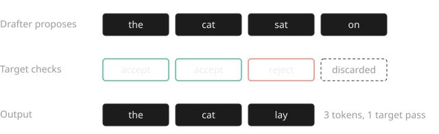

**Speculative decoding** (see the [[Speculative decoding|explainer]]) makes a large language model write faster without changing what it writes. A small, fast model guesses the next few words, and the large model checks all of the guesses at once instead of producing one word per step.

The checking rule is designed so the final text follows exactly the same probabilities as the large model alone.[^leviathan] Typical speedups are two to three times for a single user.[^chen]

## Intuition

Think of a senior editor and a quick junior writer. Writing a sentence from scratch, the editor is slow: one word, then the next. Reading a sentence someone else drafted is much faster, because the editor can look at the whole thing at once.

So the junior writes a few words ahead, the editor reads them in one pass, keeps every word up to the first one they disagree with, and writes that word themselves. When the junior is usually right, several words get finished for the cost of one careful look.

Language models behave the same way. Producing one token from a [[Transformer]] means reading every weight of the big model from memory, and that read, not the arithmetic, sets the speed. Scoring five drafted tokens reuses the same read, so checking them costs about as much as producing one.



In the rest of this article the small model is the ==drafter== and the big model is the <mark class="alt">target</mark>.

## The rule

Let *q(x)* be the ==drafter's== probability for a drafted token *x*, and *p(x)* the <mark class="alt">target's</mark> probability for the same token after the same prefix. The test is a modified form of [[Rejection sampling|rejection sampling]]. For each drafted token, in order:

1. **Accept** *x* with probability ==min(1, *p(x)* / *q(x)*)==.
2. **On the first rejection**, sample a replacement from the residual <mark class="alt">*p′(x)* ∝ max(0, *p(x)* − *q(x)*)</mark>, and throw away every draft after it.
3. **If every draft survives**, sample one bonus token from the <mark class="alt">target's</mark> next distribution.

With this rule the probability of emitting any token *x* works out to exactly *p(x)*:

```text
P(x) = q(x) * min(1, p(x)/q(x))  +  P(reject) * p'(x)
     = min(p(x), q(x))           +  max(0, p(x) - q(x))
     = p(x)
```

The second line uses the fact that the chance of a rejection equals the normaliser of the residual. At temperature 0 the rule reduces to "keep a draft while it matches the target's top token".

## Procedure

1. Run the drafter *k* times to propose *k* tokens.
2. Run the target once on the prefix plus all *k* drafts. This gives its distribution at every drafted position, plus one more.
3. Walk the drafts left to right and apply the acceptance test to each.
4. Stop at the first rejection and sample the replacement from the residual, or sample the bonus token if nothing was rejected.
5. Append the kept tokens and start the next step from the new prefix.

Each step produces at least one token and at most *k* + 1.

## Worked examples

### Example 1: greedy decoding

The prefix is *The cat sat*. The ==drafter== proposes ==on the mat==. The <mark class="alt">target</mark>, run once over all three positions, would choose <mark class="alt">on the sofa</mark>.

- Position 1: draft *on*, target *on*. Keep.
- Position 2: draft *the*, target *the*. Keep.
- Position 3: draft *mat*, target *sofa*. Reject, and emit the target's *sofa* instead.

Result: *on the sofa*, three tokens for one target step.

### Example 2: one token with sampling

At one position the <mark class="alt">target</mark> gives token A probability *p* = 0.50 and the ==drafter== gives it *q* = 0.60. The drafter proposes A.

- Acceptance probability: min(1, 0.50 / 0.60) ≈ ==0.83==.
- If the drafter had proposed token C with *p* = 0.20 and *q* = 0.05, then *p*/*q* = 4, so C is ==always kept==.

The drafter is punished only where it is overconfident compared with the target.

### Example 3: the whole distribution

A four-token vocabulary:

| Token | Target *p* | Drafter *q* | min(*p*, *q*) | max(0, *p* − *q*) |
|---|---|---|---|---|
| A | 0.50 | 0.60 | 0.50 | 0.00 |
| B | 0.20 | 0.30 | 0.20 | 0.00 |
| C | 0.20 | 0.05 | 0.05 | 0.15 |
| D | 0.10 | 0.05 | 0.05 | 0.05 |

- **Acceptance rate.** The sum of the min column: ==0.80==.
- **Residual.** The last column normalised: (0, 0, 0.75, 0.25). After a rejection, probability flows back to exactly the tokens the drafter under-proposed.
- **Check.** Add both paths for every token and you get back (0.50, 0.20, 0.20, 0.10), the <mark class="alt">target</mark> distribution.

### Example 4: tokens per step

If each draft survives independently with probability *α*, the expected number of tokens per target step with *k* drafts is (1 − *α*^(*k*+1)) / (1 − *α*).[^leviathan]

With *α* = 0.8 and *k* = 4: (1 − 0.8⁵) / 0.2 = (1 − 0.328) / 0.2 ≈ ==3.36 tokens== per target step, before paying for the drafter.

| α | k = 2 | k = 4 | k = 8 |
|---|---|---|---|
| 0.6 | 1.96 | 2.31 | 2.47 |
| 0.8 | 2.44 | 3.36 | 4.33 |
| 0.9 | 2.71 | 4.10 | 6.13 |

The gain flattens fast, because a later draft only counts if every earlier one survived.

## Common mistakes

> [!wrong] "It approximates the big model, so quality drops a little."
> Treating speculative decoding as a quality-for-speed trade.

> [!right] The output distribution is exactly the target's.
> The acceptance rule and the residual make it lossless. Only relaxed variants, such as typical acceptance, change the output.[^medusa]

> [!wrong] "Keep a draft only if it is the target's top token."
> Using the greedy test while sampling at temperature above 0.

> [!right] Keep it with probability min(1, *p*/*q*).
> The top-token test is the temperature-0 special case of this rule.

> [!wrong] "After a rejection, sample the replacement from *p*."
> Reusing the target's full distribution.

> [!right] Sample from the residual max(0, *p* − *q*), normalised.
> Sampling from *p* counts the tokens the drafter already covered twice and skews the output.

> [!wrong] "More drafts per step is always faster."
> Raising *k* without measuring.

> [!right] Pick *k* by wall-clock time on your hardware.
> Each draft costs a drafter call and makes verification heavier, while expected tokens per step flattens.[^sequoia]

## Practice problems

**1.** With *α* = 0.5 and *k* = 3, how many tokens does each target step produce on average?

> [!solution]- Show solution
> (1 − 0.5⁴) / (1 − 0.5) = (1 − 0.0625) / 0.5 = **1.875** tokens per step.

**2.** The target gives a drafted token *p* = 0.3 and the drafter gave it *q* = 0.6. What is the chance it is kept?

> [!solution]- Show solution
> min(1, 0.3 / 0.6) = **0.5**. The drafter was twice as confident as the target, so the token survives half the time.

**3.** Over two tokens, *p* = (0.7, 0.3) and *q* = (0.4, 0.6). Find the acceptance rate and the residual distribution.

> [!solution]- Show solution
> Acceptance rate: min(0.7, 0.4) + min(0.3, 0.6) = 0.4 + 0.3 = **0.7**.
>
> Residual: max(0, *p* − *q*) = (0.3, 0), which normalises to **(1, 0)**. After a rejection the first token is always chosen, because it is the one the drafter under-proposed.

**4.** In greedy decoding the drafter proposes *x y z* and the target's top tokens are *x y w*. How many tokens does the step produce? What if the target's top tokens had been *x y z*?

> [!solution]- Show solution
> First case: keep *x* and *y*, reject *z* and emit *w*, so **3 tokens**.
>
> Second case: all three drafts are kept and the target adds a bonus token, so **4 tokens** (*k* + 1).

## Key takeaways

> [!takeaways] Key takeaways
> - A cheap ==drafter== guesses *k* tokens and the <mark class="alt">target</mark> checks them all in one step.
> - Keep a draft with probability min(1, *p*/*q*). On the first rejection, sample from the residual max(0, *p* − *q*).
> - The output is exactly the target's distribution. The speedup is free in quality.
> - It pays because single-sequence decoding is limited by memory reads, not arithmetic.
> - Expected tokens per step is (1 − *α*^(*k*+1)) / (1 − *α*), and it flattens as *k* grows.

> [!tip] Exam and interview tips
> - When asked "why is it lossless?", write the two-line identity min(*p*, *q*) + max(0, *p* − *q*) = *p*.
> - State the regime: the gain is largest at batch size 1 and shrinks as batches grow.
> - Do not confuse the acceptance rate (one draft) with tokens per step (a whole block).

## Variants

| Variant | Idea | Lossless | Source |
|---|---|---|---|
| Token-wise | Accept or reject drafts one at a time along a single chain | Yes | Leviathan et al.;[^leviathan] Chen et al.[^chen] |
| Block verification | Decide the whole block jointly; never worse than token-wise, 5% to 8% faster in wall-clock time in the paper | Yes | Sun et al.[^block] |
| Tree verification | Verify a tree of candidate continuations in one pass, with an attention mask in which each node sees only its ancestors | Yes | SpecInfer;[^specinfer] Sequoia[^sequoia] |
| Multi-draft | Several independent drafts per position, coupled by optimal transport | Yes | SpecTr[^spectr] |
| Typical acceptance | Accept drafts the target finds plausible enough rather than matching its distribution exactly | No | Medusa[^medusa] |

### Drafter families

- **Separate small model.** A smaller model from the same family, sharing the tokenizer, as in the original papers.[^leviathan][^chen]
- **Extra decoding heads.** Medusa adds heads to the target that each predict a token further ahead, reporting over 2.2x speedup on a frozen backbone.[^medusa]
- **Feature-level drafter.** EAGLE drafts from the target's own hidden features, reporting 2.7x to 3.5x on LLaMA2-Chat 70B.[^eagle] EAGLE-2 adds dynamic draft trees,[^eagle2] and EAGLE-3 reports up to 6.5x.[^eagle3]
- **No drafter.** Prompt lookup decoding copies n-grams from the prompt.[^pld] Lookahead decoding needs no auxiliary model at all.[^lookahead]

### Libraries and engines

vLLM supports separate draft models, n-gram matching, EAGLE and multi-token-prediction heads.[^vllm] SGLang lists EAGLE-2, EAGLE-3, multi-token prediction, classic draft models and an n-gram variant.[^sglang] Hugging Face Transformers calls the technique assisted decoding.[^hf]

## Limitations

- **Batch size.** The spare compute that drafts use shrinks as the batch grows. EAGLE-3 reports a 1.38x throughput gain at batch size 64 in SGLang, well below its single-sequence figure.[^eagle3]
- **Drafter mismatch.** A drafter that matches the target poorly on real traffic can cost more than it saves.
- **Lossy variants.** Relaxed acceptance rules trade the exact-distribution guarantee for more accepted tokens.[^medusa]

## History

Blockwise parallel decoding (Stern, Shazeer and Uszkoreit, 2018) first had a model propose several tokens and check them in parallel, for greedy decoding.[^stern] Leviathan, Kalman and Matias at Google (2022) and Chen and colleagues at DeepMind (2023) independently introduced the sampling-safe acceptance rule that keeps the target distribution exact.[^leviathan][^chen] Tree verification, extra decoding heads and feature-level drafters followed in 2023 and 2024, and the major open-source serving engines now ship the technique.[^vllm][^sglang]

## Glossary

- **Target model**: the large model whose output distribution must be preserved.
- **Drafter**: the cheap proposer of candidate tokens: a small model, extra heads, or a lookup rule.
- **Acceptance rate (α)**: the probability that a drafted token survives verification.
- **Residual distribution**: the normalised positive part of *p − q*, sampled after a rejection.
- **Bonus token**: the extra token sampled from the target when every draft in a block is accepted.
- **Token tree**: several candidate continuations sharing prefixes, verified together with a tree attention mask.

[^leviathan]: Yaniv Leviathan, Matan Kalman, Yossi Matias. "Fast Inference from Transformers via Speculative Decoding." ICML 2023. arXiv:2211.17192. https://arxiv.org/abs/2211.17192
[^chen]: Charlie Chen, Sebastian Borgeaud, Geoffrey Irving, et al. "Accelerating Large Language Model Decoding with Speculative Sampling." 2023. arXiv:2302.01318. https://arxiv.org/abs/2302.01318
[^stern]: Mitchell Stern, Noam Shazeer, Jakob Uszkoreit. "Blockwise Parallel Decoding for Deep Autoregressive Models." NeurIPS 2018. arXiv:1811.03115. https://arxiv.org/abs/1811.03115
[^vllm]: vLLM project. "Speculative Decoding." vLLM documentation. https://docs.vllm.ai/en/latest/features/speculative_decoding/
[^sglang]: SGLang project. "Speculative Decoding." SGLang documentation. https://docs.sglang.ai/advanced_features/speculative_decoding.html
[^medusa]: Tianle Cai, Yuhong Li, Zhengyang Geng, et al. "Medusa: Simple LLM Inference Acceleration Framework with Multiple Decoding Heads." 2024. arXiv:2401.10774. https://arxiv.org/abs/2401.10774
[^sequoia]: Zhuoming Chen, Avner May, Ruslan Svirschevski, et al. "Sequoia: Scalable, Robust, and Hardware-aware Speculative Decoding." 2024. arXiv:2402.12374. https://arxiv.org/abs/2402.12374
[^block]: Ziteng Sun, Uri Mendlovic, Yaniv Leviathan, et al. "Block Verification Accelerates Speculative Decoding." 2024. arXiv:2403.10444. https://arxiv.org/abs/2403.10444
[^specinfer]: Xupeng Miao, Gabriele Oliaro, Zhihao Zhang, et al. "SpecInfer: Accelerating Generative Large Language Model Serving with Tree-based Speculative Inference and Verification." 2023. arXiv:2305.09781. https://arxiv.org/abs/2305.09781
[^spectr]: Ziteng Sun, Ananda Theertha Suresh, Jae Hun Ro, et al. "SpecTr: Fast Speculative Decoding via Optimal Transport." NeurIPS 2023. arXiv:2310.15141. https://arxiv.org/abs/2310.15141
[^eagle]: Yuhui Li, Fangyun Wei, Chao Zhang, Hongyang Zhang. "EAGLE: Speculative Sampling Requires Rethinking Feature Uncertainty." 2024. arXiv:2401.15077. https://arxiv.org/abs/2401.15077
[^eagle2]: Yuhui Li, Fangyun Wei, Chao Zhang, Hongyang Zhang. "EAGLE-2: Faster Inference of Language Models with Dynamic Draft Trees." 2024. arXiv:2406.16858. https://arxiv.org/abs/2406.16858
[^eagle3]: Yuhui Li, Fangyun Wei, Chao Zhang, Hongyang Zhang. "EAGLE-3: Scaling up Inference Acceleration of Large Language Models via Training-Time Test." 2025. arXiv:2503.01840. https://arxiv.org/abs/2503.01840
[^pld]: Apoorv Saxena. "Prompt Lookup Decoding." GitHub repository, 2023. https://github.com/apoorvumang/prompt-lookup-decoding
[^lookahead]: Yichao Fu, Peter Bailis, Ion Stoica, Hao Zhang. "Break the Sequential Dependency of LLM Inference Using Lookahead Decoding." 2024. arXiv:2402.02057. https://arxiv.org/abs/2402.02057
[^hf]: Hugging Face. "Assisted decoding." Transformers documentation. https://huggingface.co/docs/transformers/main/en/assisted_decoding
