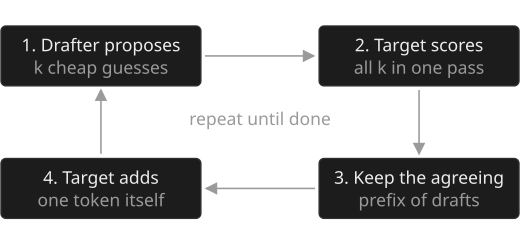

**Speculative decoding** is a technique that makes a large language model generate text faster without changing what it generates. A small, fast model guesses the next few tokens, and the large model checks all of the guesses in a single step instead of producing one token per step.[^leviathan]

It exists because generating text one token at a time leaves most of a GPU idle. Checking several guesses costs about the same as producing one token, so every guess the large model agrees with is close to free. Typical speedups are two to three times for a single user.[^chen] A study guide with practice problems is at [[Speculative decoding (study guide)]].

## Intuition

Think of a senior editor and a quick junior writer. Writing a sentence from scratch, the editor is slow: one word, then the next. Reading a sentence someone else drafted is much faster, because the editor can take in the whole thing at once. So the junior writes ahead, and the editor keeps every word up to the first one they would change.

Language models have the same asymmetry. A [[Transformer]] writes one token at a time, and to produce each token the GPU has to read every weight of the model from memory. For one user at a time, that memory read, not the arithmetic, sets the speed, so the chip could check several tokens in the time it takes to write one. Speculative decoding spends that spare capacity on checking guesses.

## How it works

Two models take part. The **target model** is the large model whose output you want. The **drafter** is a much cheaper source of guesses: a small model from the same family, extra prediction heads on the target, or even a lookup in the prompt.

Each step of the loop has four parts.

1. **Draft.** The drafter proposes the next *k* tokens, one after another. This is fast because the drafter is small.
2. **Verify.** The target runs once on the text plus all *k* drafts. Because a transformer scores every position of its input in parallel, this one pass gives the target's own prediction at each drafted position.
3. **Accept.** Walking left to right, each draft is kept or rejected by an acceptance test. The first rejection ends the walk, and every draft after it is thrown away.
4. **Correct.** The target supplies one token itself: a replacement at the rejected position, or a bonus token after the last draft if all of them were kept.

So every step produces at least one token, exactly as plain decoding would, and up to *k* + 1 when the drafter guessed well.

The acceptance test is what keeps the output unchanged. A draft *x* is kept with probability min(1, *p(x)* / *q(x)*), where *p* is the target's probability for it and *q* the drafter's. After a rejection, the replacement is sampled from the normalised positive part of *p* − *q*. Together these make the probability of emitting any token exactly *p(x)*, the same as sampling from the target directly.[^leviathan][^chen] With greedy decoding the test reduces to keeping drafts while they match the target's top token.

## Walk-through

Take the prefix *The cat sat*, greedy decoding and *k* = 3.

- **Draft.** The drafter proposes *on*, *the*, *mat*.
- **Verify.** One target pass over *The cat sat on the mat* shows that its own choices at those three positions would be *on*, *the*, *sofa*.
- **Accept.** *on* matches and is kept. *the* matches and is kept. *mat* does not match, so it is rejected.
- **Correct.** The target's own token at that position, *sofa*, is used instead.

The step outputs *on the sofa*: three tokens for one pass of the large model, where plain decoding would have needed three passes. The text is exactly what the target would have written on its own.

How many tokens a step yields on average depends on how often drafts are accepted. If each draft survives with probability *α*, a step with *k* drafts yields (1 − *α*^(*k*+1)) / (1 − *α*) tokens on average.[^leviathan] At *α* = 0.8 and *k* = 4 that is about 3.4 tokens per target pass, before the drafter's own cost.

## Variants

| Variant | Idea | Output unchanged | Source |
|---|---|---|---|
| Token-wise | Accept or reject drafts one at a time along a single chain | Yes | Leviathan et al.;[^leviathan] Chen et al.[^chen] |
| Block verification | Decide the whole block jointly; never worse than token-wise, 5% to 8% faster in wall-clock time in the paper | Yes | Sun et al.[^block] |
| Tree verification | Verify a tree of candidate continuations in one pass, with an attention mask in which each node sees only its ancestors | Yes | SpecInfer;[^specinfer] Sequoia[^sequoia] |
| Multi-draft | Several independent drafts per position, coupled by optimal transport | Yes | SpecTr[^spectr] |
| Typical acceptance | Accept drafts the target finds plausible enough rather than matching its distribution exactly | No | Medusa[^medusa] |

### Drafter families

- **Separate small model.** A smaller model from the same family, sharing the tokenizer, as in the original papers.[^leviathan][^chen]
- **Extra decoding heads.** Medusa adds heads to the target that each predict a token further ahead, reporting over 2.2x speedup on a frozen backbone.[^medusa]
- **Feature-level drafter.** EAGLE drafts from the target's own hidden features, reporting 2.7x to 3.5x on LLaMA2-Chat 70B.[^eagle] EAGLE-2 adds dynamic draft trees,[^eagle2] and EAGLE-3 reports up to 6.5x.[^eagle3]
- **No drafter.** Prompt lookup decoding copies n-grams from the prompt.[^pld] Lookahead decoding needs no auxiliary model at all.[^lookahead]

## Reference details

### Libraries and engines

vLLM supports separate draft models, n-gram matching, EAGLE and multi-token-prediction heads.[^vllm] SGLang lists EAGLE-2, EAGLE-3, multi-token prediction, classic draft models and an n-gram variant.[^sglang] Hugging Face Transformers calls the technique assisted decoding.[^hf]

### Limitations

- **Batch size.** The spare compute that drafts use shrinks as the batch grows. EAGLE-3 reports a 1.38x throughput gain at batch size 64 in SGLang, well below its single-sequence figure.[^eagle3]
- **Drafter mismatch.** A drafter that matches the target poorly on real traffic can cost more than it saves.
- **Choosing k.** More drafts per step make verification heavier while the expected yield flattens, so *k* is best tuned by wall-clock time on the target hardware.[^sequoia]
- **Lossy variants.** Relaxed acceptance rules trade the exact-distribution guarantee for more accepted tokens.[^medusa]

### History

Blockwise parallel decoding (Stern, Shazeer and Uszkoreit, 2018) first had a model propose several tokens and check them in parallel, for greedy decoding.[^stern] Leviathan, Kalman and Matias at Google (2022) and Chen and colleagues at DeepMind (2023) independently introduced the sampling-safe acceptance rule that keeps the target distribution exact.[^leviathan][^chen] Tree verification, extra decoding heads and feature-level drafters followed in 2023 and 2024, and the major open-source serving engines now ship the technique.[^vllm][^sglang]

### Glossary

- **Target model**: the large model whose output distribution must be preserved.
- **Drafter**: the cheap proposer of candidate tokens: a small model, extra heads, or a lookup rule.
- **Acceptance rate (α)**: the probability that a drafted token survives verification.
- **Residual distribution**: the normalised positive part of *p − q*, sampled after a rejection.
- **Bonus token**: the extra token sampled from the target when every draft in a block is accepted.
- **Token tree**: several candidate continuations sharing prefixes, verified together with a tree attention mask.

[^leviathan]: Yaniv Leviathan, Matan Kalman, Yossi Matias. "Fast Inference from Transformers via Speculative Decoding." ICML 2023. arXiv:2211.17192. https://arxiv.org/abs/2211.17192
[^chen]: Charlie Chen, Sebastian Borgeaud, Geoffrey Irving, et al. "Accelerating Large Language Model Decoding with Speculative Sampling." 2023. arXiv:2302.01318. https://arxiv.org/abs/2302.01318
[^stern]: Mitchell Stern, Noam Shazeer, Jakob Uszkoreit. "Blockwise Parallel Decoding for Deep Autoregressive Models." NeurIPS 2018. arXiv:1811.03115. https://arxiv.org/abs/1811.03115
[^vllm]: vLLM project. "Speculative Decoding." vLLM documentation. https://docs.vllm.ai/en/latest/features/speculative_decoding/
[^sglang]: SGLang project. "Speculative Decoding." SGLang documentation. https://docs.sglang.ai/advanced_features/speculative_decoding.html
[^medusa]: Tianle Cai, Yuhong Li, Zhengyang Geng, et al. "Medusa: Simple LLM Inference Acceleration Framework with Multiple Decoding Heads." 2024. arXiv:2401.10774. https://arxiv.org/abs/2401.10774
[^sequoia]: Zhuoming Chen, Avner May, Ruslan Svirschevski, et al. "Sequoia: Scalable, Robust, and Hardware-aware Speculative Decoding." 2024. arXiv:2402.12374. https://arxiv.org/abs/2402.12374
[^block]: Ziteng Sun, Uri Mendlovic, Yaniv Leviathan, et al. "Block Verification Accelerates Speculative Decoding." 2024. arXiv:2403.10444. https://arxiv.org/abs/2403.10444
[^specinfer]: Xupeng Miao, Gabriele Oliaro, Zhihao Zhang, et al. "SpecInfer: Accelerating Generative Large Language Model Serving with Tree-based Speculative Inference and Verification." 2023. arXiv:2305.09781. https://arxiv.org/abs/2305.09781
[^spectr]: Ziteng Sun, Ananda Theertha Suresh, Jae Hun Ro, et al. "SpecTr: Fast Speculative Decoding via Optimal Transport." NeurIPS 2023. arXiv:2310.15141. https://arxiv.org/abs/2310.15141
[^eagle]: Yuhui Li, Fangyun Wei, Chao Zhang, Hongyang Zhang. "EAGLE: Speculative Sampling Requires Rethinking Feature Uncertainty." 2024. arXiv:2401.15077. https://arxiv.org/abs/2401.15077
[^eagle2]: Yuhui Li, Fangyun Wei, Chao Zhang, Hongyang Zhang. "EAGLE-2: Faster Inference of Language Models with Dynamic Draft Trees." 2024. arXiv:2406.16858. https://arxiv.org/abs/2406.16858
[^eagle3]: Yuhui Li, Fangyun Wei, Chao Zhang, Hongyang Zhang. "EAGLE-3: Scaling up Inference Acceleration of Large Language Models via Training-Time Test." 2025. arXiv:2503.01840. https://arxiv.org/abs/2503.01840
[^pld]: Apoorv Saxena. "Prompt Lookup Decoding." GitHub repository, 2023. https://github.com/apoorvumang/prompt-lookup-decoding
[^lookahead]: Yichao Fu, Peter Bailis, Ion Stoica, Hao Zhang. "Break the Sequential Dependency of LLM Inference Using Lookahead Decoding." 2024. arXiv:2402.02057. https://arxiv.org/abs/2402.02057
[^hf]: Hugging Face. "Assisted decoding." Transformers documentation. https://huggingface.co/docs/transformers/main/en/assisted_decoding
